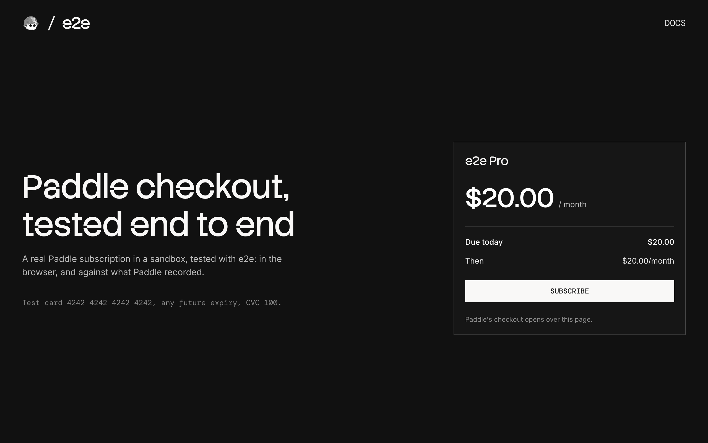

# e2e-paddle

A checkout that takes real Paddle payments in a sandbox, used as an example of end-to-end testing a payment page you don't own with [e2e](https://www.npmjs.com/package/e2e).



## How it works

The checkout sells one monthly subscription with Paddle's overlay checkout, the flow Paddle recommends: Paddle's checkout opens in an iframe over our page, and the shopper pays there.

- **Checkout** (`app/page.tsx`, `components/plan-checkout.tsx`) shows the plan and a Subscribe button, and opens Paddle's checkout with Paddle.js.
- **`POST /checkout`** (`app/checkout/route.ts`) creates a Paddle transaction for the plan.
- **Return page** (`app/return/page.tsx`) asks Paddle for the transaction and the subscription it created, and shows the result.

The price comes from the server and is described inline with the transaction, so a fresh sandbox needs no products or prices; a real app would use a price from its catalog. The return page checks with Paddle instead of trusting the URL, and there is no database: Paddle holds the state.

### Test cards

| Card number           | Result             |
| --------------------- | ------------------ |
| `4242 4242 4242 4242` | Subscribes         |
| `4000 0000 0000 0002` | Declined           |
| `4000 0038 0000 0446` | Asks for 3D Secure |

Use any name, any future expiry date, and CVC `100`.

## Getting started

```bash
npm install
npm run dev
```

Open [http://localhost:3000](http://localhost:3000).

### Paddle sandbox

Everything runs in a free Paddle sandbox. Sign up at [sandbox-vendors.paddle.com](https://sandbox-vendors.paddle.com/signup), then:

1. Create an API key (`pdl_sdbx_apikey_…`) under **Developer tools → Authentication → API keys**, with read and write access to transactions and subscriptions.
2. Create a client-side token (`test_…`) on the same page.
3. Set a default payment link under **Checkout → Checkout settings**. Paddle creates no transactions until one is set, and it must be an `https` URL, so `http://localhost:3000` won't do. Any `https` URL works: this checkout never opens the link.

Copy `.env.example` to `.env.local` and set `PADDLE_API_KEY` and `NEXT_PUBLIC_PADDLE_CLIENT_TOKEN`.

## End-to-end tests

The tests in `tests/overlay.e2e.ts` pay in Paddle's real checkout: a subscription that starts, a declined card, 3D Secure completed and failed, and closing the checkout. The agent fills in and clicks through Paddle's checkout with `agent.act`, and checks it with `agent.assert`; our own pages use exact locators. Each test then checks what Paddle recorded through its API, the transaction and the subscription, and cancels any subscription it started. A failed test runs up to two more times before it counts as failed.

The agent model goes through the Vercel AI Gateway, so set `AI_GATEWAY_API_KEY` (or link a Vercel project). Then, with the dev server running:

```bash
npm run test:e2e
```

To test a different URL, set `APP_URL`. Configuration lives in `e2e.config.ts`.

## Scripts

| Command            | Description          |
| ------------------ | -------------------- |
| `npm run dev`      | Start the dev server |
| `npm run build`    | Build for production |
| `npm run lint`     | Run ESLint           |
| `npm run format`   | Format with Prettier |
| `npm run test:e2e` | Run the e2e tests    |
